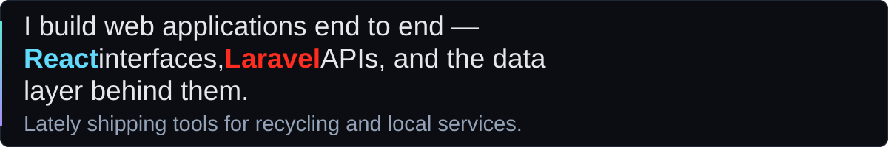
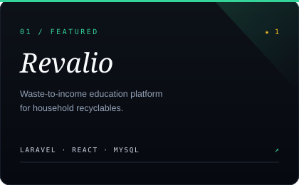
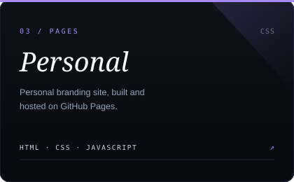
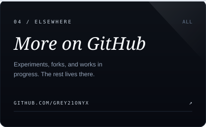
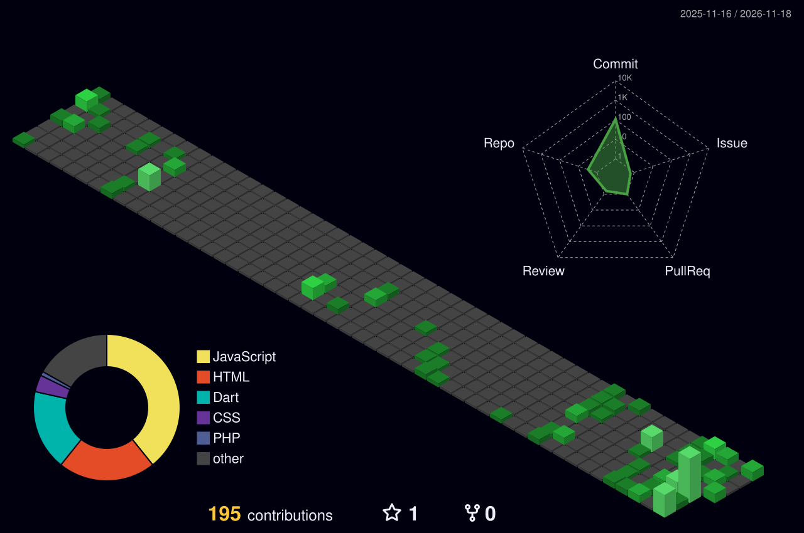
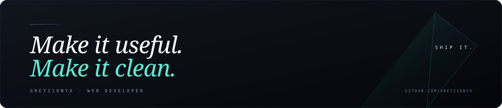

  

<table>
  <tr>
    <td width="65%" valign="top" align="justify">

<h3>Web developer building practical software — recycling platforms, local service apps, and the details in between.</h3>

  

    </td>
    <td width="35%" align="center" valign="middle">
      
    </td>
  </tr>
</table>

  

---

  

<table>
<tr>
<td align="center" width="33%">

### Languages

</td>

<td align="center" width="34%">

### Frameworks & Tools

</td>

<td align="center" width="33%">

### Databases & Backend

</td>
</tr>
</table>

---

  

<table>
  <tr>
    <td width="50%" valign="top" align="center">
      
    </td>
    <td width="50%" valign="top" align="center">
      
    </td>
  </tr>
  <tr>
    <td width="50%" valign="top" align="center">
      
    </td>
    <td width="50%" valign="top" align="center">
      
    </td>
  </tr>
</table>

  More experiments and side quests on <a href="https://github.com/grey21onyx?tab=repositories">GitHub</a>.

---

  

  

---

  

<!---
grey21onyx/grey21onyx is a ✨ special ✨ repository because its README.md (this file) appears on your GitHub profile.
You can click the Preview link to take a look at your changes.
--->
